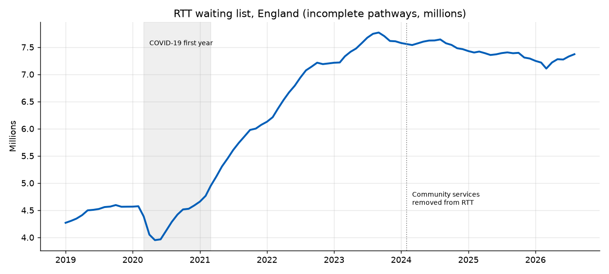
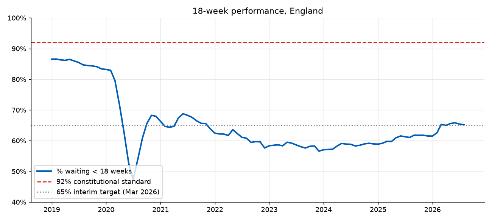
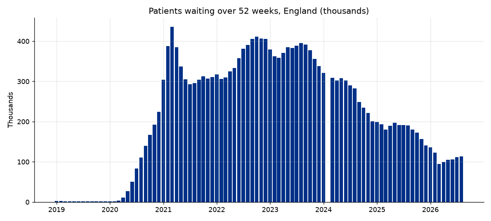
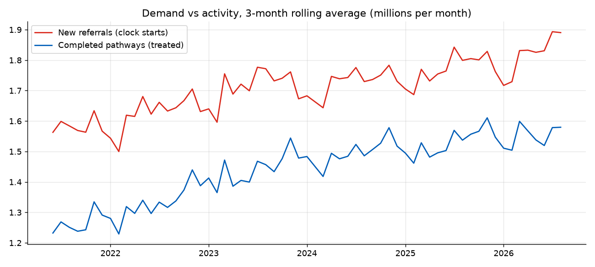
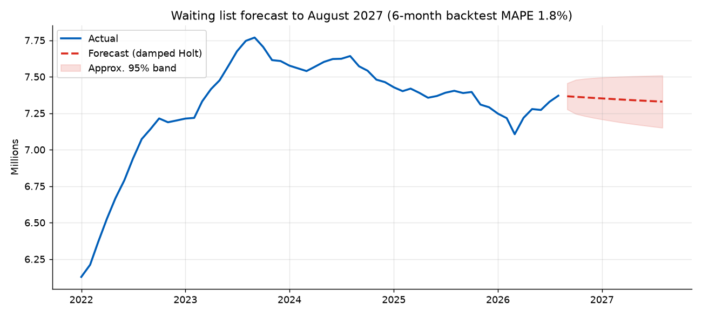
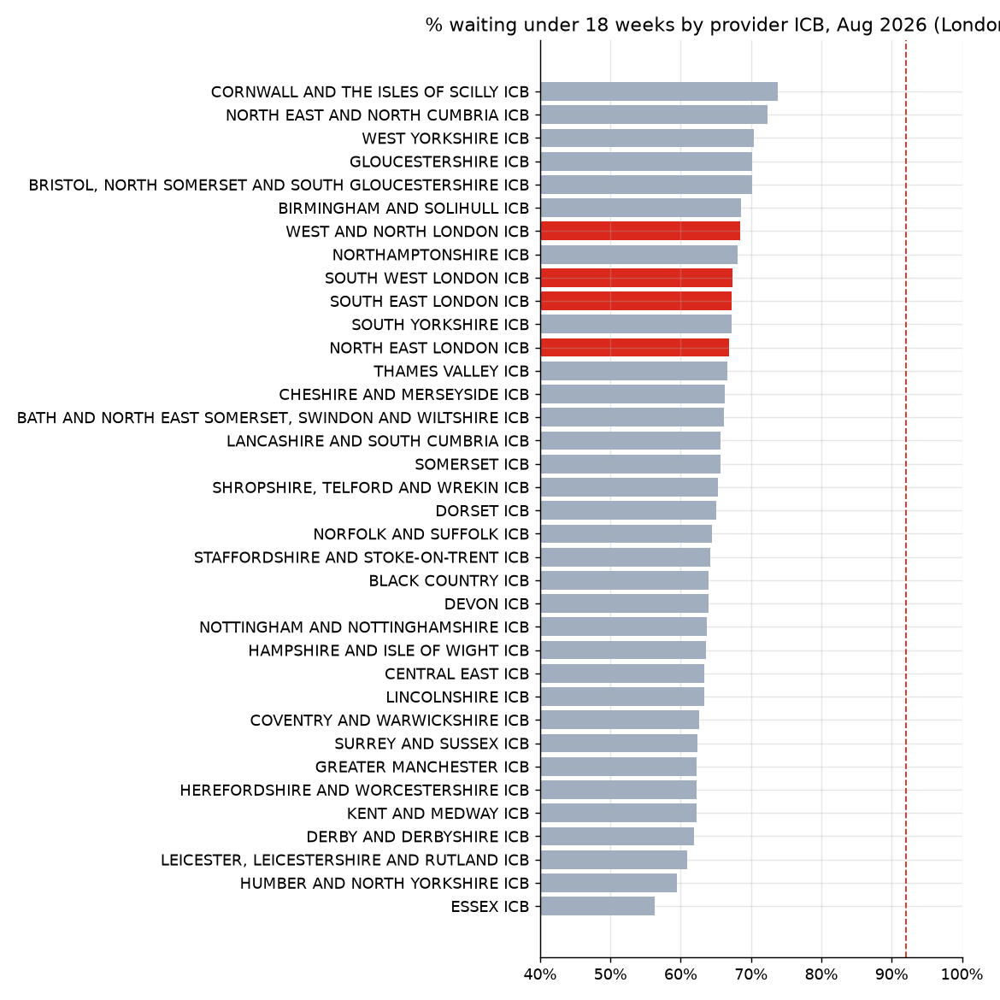
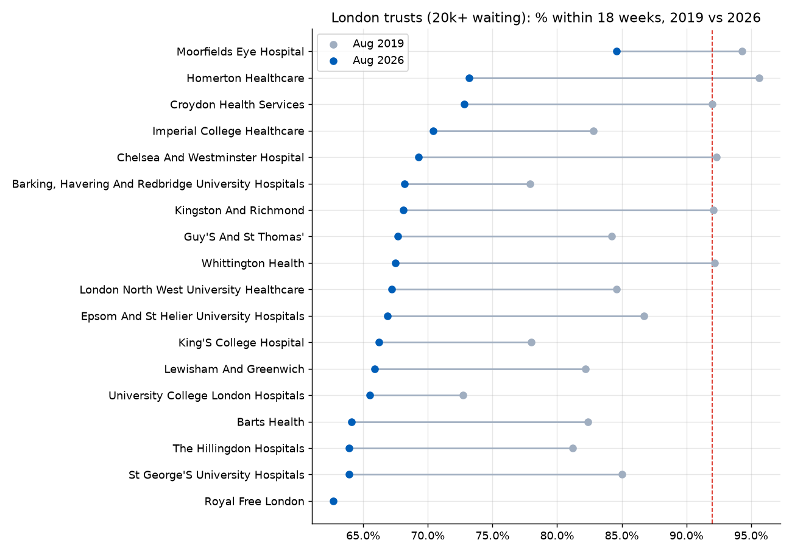
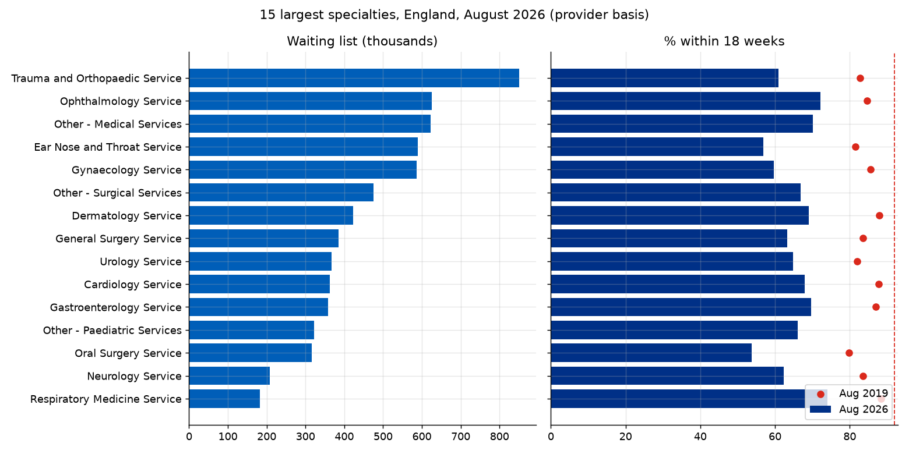

# NHS England waiting times: the elective backlog, 2019 to 2026

An end-to-end analysis of NHS England **Referral to Treatment (RTT)** waiting times, from raw official
spreadsheets to SQL analysis, a forecast and an interactive Streamlit dashboard, with a focus on London.

Author: Anthony Adusei-Poku ([@anthony07-max](https://github.com/anthony07-max))



## Key findings (data to August 2026)

| Measure (England) | Aug 2019 | Aug 2026 |
|---|---|---|
| Waiting list (incomplete pathways) | 4.56m | **7.37m** (+61.7%) |
| % waiting under 18 weeks (standard: 92%) | 84.7% | **65.2%** |
| Waiting over 52 weeks | 1,468 | **113,339** |
| Median wait | 8.0 weeks | **12.2 weeks** |

1. **The backlog peaked at 7.77m in September 2023** and has eased only slightly since. At 7.37m it is
   still 62% bigger than before the pandemic.
2. **The 92% standard was last met in September 2015.** Performance is now 65.2%, around the
   interim target of 65% set for March 2026.
3. **52-week waits are down 74% from their peak** of 436,127 (March 2021), but they are still about 77 times the August 2019 level.
4. **Trauma & Orthopaedics is the largest specialty** (851k waiting, 60.9% within 18 weeks).
   The worst large specialties are Oral Surgery (53.8%), ENT (56.8%) and Plastic Surgery (59.4%).
5. **London does slightly better than the rest of England:** 67.7% within 18 weeks against 64.6%
   (1.30m waiting at London providers). In 2019 London was slightly *behind* (84.4% against 85.1%).
   All four London ICBs rank in the top 12 of 36 provider ICBs. Cornwall is best (73.8%) and Essex is worst (56.3%).
6. **Every large London trust has declined since 2019.** Homerton (95.6% to 73.2%), Chelsea & Westminster
   (92.3% to 69.3%) and Whittington (92.2% to 67.5%) fell the most. Royal Free has the biggest London list
   (137,947) and the lowest performance (62.7%). Moorfields is the strongest (84.6%).
7. **Forecast:** a damped Holt model (6-month backtest MAPE 1.8%) projects about **7.33m in August 2027**
   (approximate range 7.15m to 7.51m). On current trends the list stays flat rather than clearing.

| | |
|---|---|
|  |  |
|  |  |
|  |  |



## Data sources (all public, NHS England Statistics)
- [Consultant-led RTT waiting times, main page](https://www.england.nhs.uk/statistics/statistical-work-areas/rtt-waiting-times/)
- [RTT overview time series, Apr 2007 to Aug 2026](https://www.england.nhs.uk/statistics/wp-content/uploads/sites/2/2026/10/RTT-Overview-Timeseries-Including-Estimates-for-Missing-Trusts-Aug26-XLS-139K-vjgRdG.xlsx) (national, includes estimates for missing trusts)
- [Full CSV extract, August 2026](https://www.england.nhs.uk/statistics/statistical-work-areas/rtt-waiting-times/rtt-data-2026-27/) (provider × commissioner × specialty)
- [Full CSV extract, August 2019](https://www.england.nhs.uk/statistics/statistical-work-areas/rtt-waiting-times/rtt-data-2019-20/) (pre-pandemic baseline)
- [RTT statistics user guidance](https://www.england.nhs.uk/statistics/statistical-work-areas/rtt-waiting-times/rtt-statistics-user-guidance/)

## Project structure
```
src/download.py      # fetches the raw files into data/raw/
src/clean.py         # tidies the time series and the provider/specialty extracts into data/processed/
src/analysis.py      # SQL (SQLite) analysis, forecast, charts, key_findings.json
app/streamlit_app.py # interactive dashboard
charts/              # PNG outputs
data/processed/      # tidy CSVs used by the dashboard
```

## How to run
```bash
python -m venv .venv && source .venv/bin/activate
pip install -r requirements.txt
./run_pipeline.sh                      # download, clean, analyse
streamlit run app/streamlit_app.py     # dashboard at http://localhost:8501
```

## Method notes and limitations
- The waiting list is the number of **incomplete pathways**, not patients. One patient can be on more than one pathway.
- National figures use NHS England's commissioner-based series *with estimates for missing trusts*.
  Specialty, ICB and trust figures come from the provider-based extract (7.19m in August 2026), so the totals differ slightly.
- "London" means providers whose parent organisation is a London ICB (2026) or NHS England London region (2019).
  The four London ICBs are North East, South East, South West, and West & North London.
- Since February 2024, community services are no longer in RTT data. This is a definitional break, so the forecast is fitted only on data from March 2024 onwards.
- Royal Free London did not report RTT data in August 2019, so it has no 2019 comparison.
- The forecast band is a heuristic interval based on in-sample residuals. It is not a formal prediction interval.
- Monthly file URLs include a random suffix. When a newer month is published, update `src/download.py` from the yearly data pages.
